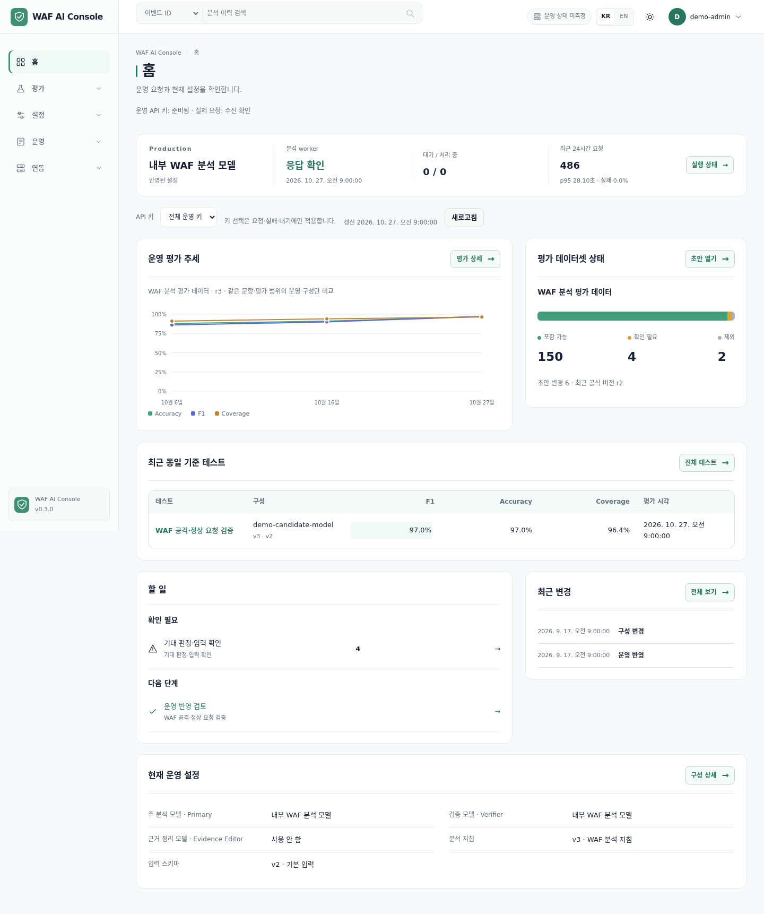
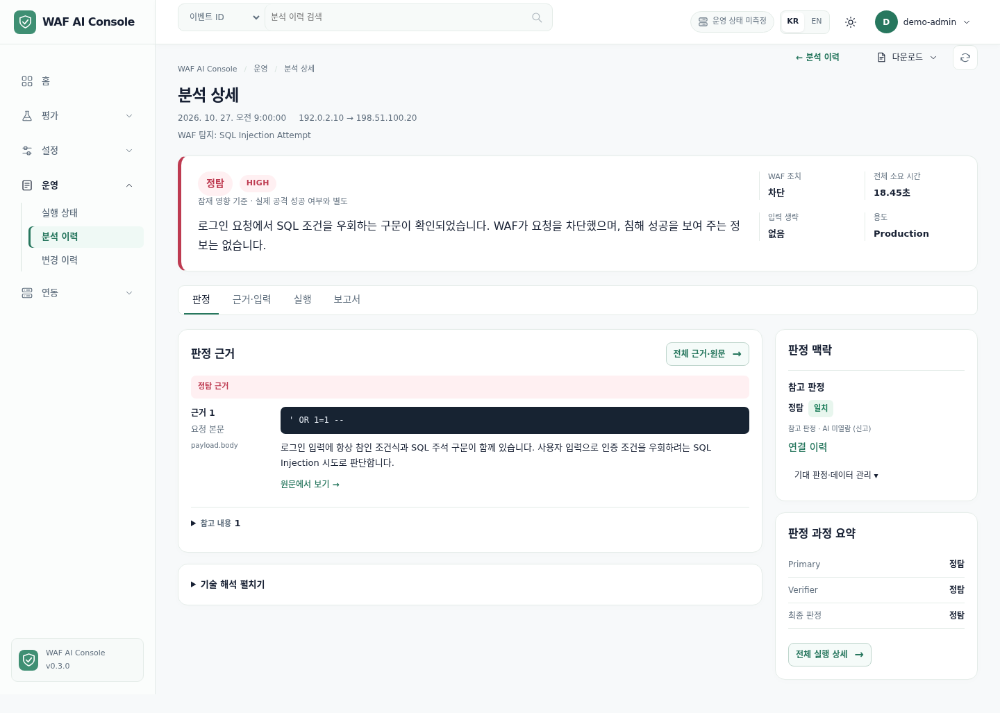
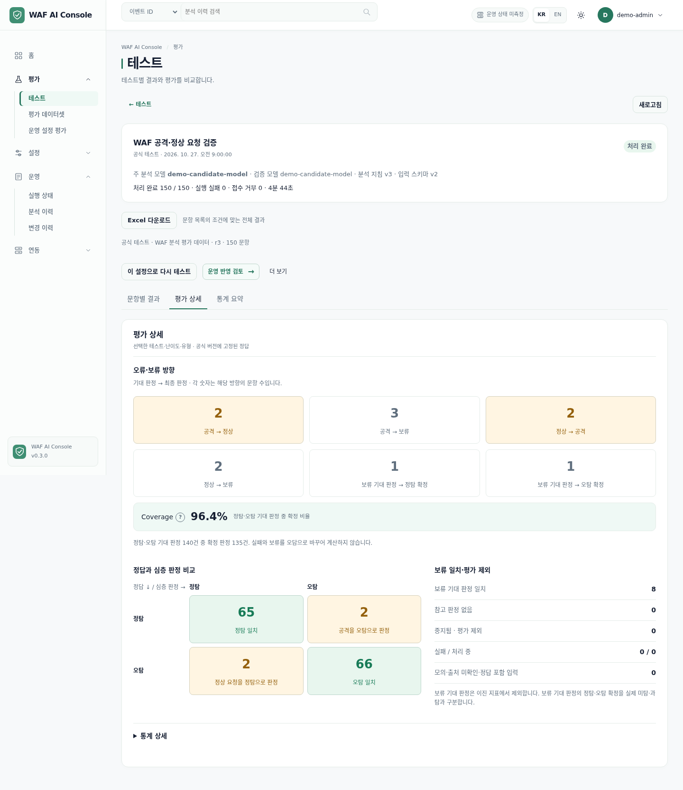

# WAF AI Console

WAF 로그의 **정탐·오탐·판정 보류**와 판단 근거를 분석하고, 테스트부터 운영 적용까지 관리하는 보안 분석 지원 도구입니다.

내부 vLLM 또는 승인된 OpenAI 프로필로 요청을 분석합니다. 분석가는 판정과 심각도, 원문에 연결된 근거를 확인하고 참고 판정과 비교할 수 있습니다. AI가 WAF 정책을 자동 변경하거나 사람의 최종 판단을 대신하지 않습니다.

## 주요 기능

| 영역 | 기능 |
| --- | --- |
| 위협 분석 | 정탐·오탐·보류, 심각도, 분석 요약, 공격 요청 근거·정상 요청 근거·참고 내용 구분 |
| 원문 확인 | HTTP 원문, 인코딩 전후 비교, 근거 출처 확인, 관리자 열람 감사 |
| Agent 실행 | Primary → 조건부 독립 Verifier → 서버 최종 판정 → 선택적 근거 정리 |
| 테스트 | 단건 입력·배치 파일·평가 데이터셋 분석, Test API 키, 문항별 결과·재실행·중지 |
| 품질 평가 | 정탐·오탐·보류 비교, Confusion Matrix, Accuracy·Precision·Recall·F1 등 지표, 실행 비교 |
| 통계 | 시그니처·회사·WAF 조치 등 1~3개 필드 조합 집계, AND/OR 필터, 판정 불일치 분석, 테스트별 파싱·추가 검증 사유 집계 |
| 파서 관리 | 벤더·payload 형식별 프로필, 버전 고정, 원문·파싱 비교, 내부 vLLM 개선안, 공식 평가 후 운영 반영 |
| 데이터 관리 | 평가 데이터셋 편집·버전 관리, 참고 판정 연결, 공식 평가 기준 고정 |
| 운영 구성 | 모델 역할·분석 지침·입력 스키마를 공식 테스트와 관리자 검토를 거쳐 운영에 반영 |
| 결과 공유 | 단건 PDF 보고서, 필터와 선택 컬럼을 반영한 테스트 Excel, Markdown 보고서 |
| 연동·피드백 | Production/Test API 키, 비동기 분석 접수·조회, 복수 선택형 피드백 API |
| 화면 | 한국어·영어 공통 UI, SK·Light·Dark 테마, 브라우저 뒤로/앞으로 가기 |

Verifier는 Primary의 답변을 받지 않고 같은 입력을 별도로 분석합니다. 필요한 검증이 실패하거나 판정이 다르면 서버 정책에 따라 보류합니다. 근거 정리 모델은 표시할 근거를 묶을 뿐 최종 판정을 바꾸지 않습니다.

새 후보 지침 `v2.16`은 공격 요청 근거·정상 요청 근거·참고 내용을 구분하는 엄격한 `waf-analysis-v3` 결과를 사용합니다. 분석 요약과 최종 판정 이유를 분리하고 튜닝·일반 후속 확인 생성은 제외합니다. JSON 중복 값은 동일·차이·비교 불가로 구분하되 공격이나 정상으로 자동 판정하지 않습니다. 승인된 운영 구성과 기존 `v2.15` 실행은 변경하지 않습니다. 기존 서비스 API 응답은 기본 v2 호환 형식을 유지하며 `result_version=v3`로 새 형식을 선택합니다. [결과 계약과 전환 안내](backend/app/data/result_contract_v3.md)

## 스크린샷

현행 React 화면에 **가상 데이터**를 넣어 촬영한 예시입니다. 실제 고객사 로그·API 키·운영 실적이나 측정된 모델 성능을 나타내지 않습니다.

### 홈



### 분석 상세



### 테스트 평가



## 구성

| 구성요소 | 기술·역할 |
| --- | --- |
| Backend | Python 3.12+, FastAPI, SQLAlchemy, Alembic |
| 저장소·큐 | SQLite WAL, 암호화 원문·실행 기록, lease 기반 비동기 worker |
| Frontend | React, Vite, TanStack Table |
| Agent | `moduagent==0.6.2`, 구조화 출력 검증과 교정 재시도 |
| LLM | 별도 운영하는 vLLM / OpenAI 공식 API |
| 보고서 | Markdown, ReportLab PDF, Excel — 운영용 Chromium 설치 불필요 |
| 배포 | Docker Compose, API·분석 worker·모델 검증 worker·웹 분리 |

GPU와 vLLM 서버는 이 프로젝트에 포함하지 않습니다. Console 서버가 별도 추론 서버로 요청을 보냅니다. SQLite 데이터는 한 호스트의 로컬 디스크에 보관하며 여러 서버나 NFS/SMB로 공유하지 않습니다.

## 빠른 시작 — 로컬 확인

Docker Engine·Docker Compose 플러그인·Git·Python 3가 필요합니다. 아래는 **새 설치** 기준입니다.

```bash
git clone --branch main https://github.com/nagix999/waf-ai-console.git
cd waf-ai-console
```

다음 함수를 같은 터미널에서 정의합니다. 템플릿으로부터 관리자 비밀번호·세션 비밀키·Fernet 키를 새로 생성해 권한 `0600`의 환경 파일에만 기록합니다. 기존 파일은 덮어쓰지 않습니다.

```bash
create_waf_env() {
  python3 - "$@" <<'PY'
import base64
import os
import re
import secrets
import sys
from pathlib import Path

template, destination = sys.argv[1:]
content = Path(template).read_text(encoding="utf-8")
values = {
    "WAF_ADMIN_PASSWORD": secrets.token_urlsafe(32) + "Aa1!",
    "WAF_SESSION_SECRET": secrets.token_urlsafe(48),
    "WAF_DATA_ENCRYPTION_KEY": base64.urlsafe_b64encode(secrets.token_bytes(32)).decode(),
}
for key, value in values.items():
    content, count = re.subn(r"(?m)^" + key + r"=.*$", key + "=" + value, content)
    if count != 1:
        raise SystemExit("Check template setting: " + key)
flags = os.O_WRONLY | os.O_CREAT | os.O_EXCL | os.O_NOFOLLOW
with os.fdopen(os.open(destination, flags, 0o600), "w", encoding="utf-8") as output:
    output.write(content)
print("Environment file created; secret values were not printed.")
PY
}

create_waf_env .env.example .env
docker compose up -d --build
docker compose ps
```

- 웹: <http://localhost:8080>
- Swagger: <http://localhost:8000/docs>
- 관리자: `.env`의 `WAF_ADMIN_USERNAME` / `WAF_ADMIN_PASSWORD`로 로그인합니다. 비밀번호는 안전한 편집기로 확인합니다.
- 최초 서비스 API 키는 없습니다. 관리자 화면의 **연동 → API 키**에서 발급합니다.

기본 실행 모드는 `stub`입니다. 접수·화면·처리 흐름 확인용이며 실제 LLM 판정이나 품질 평가가 아닙니다. 실제 분석을 준비할 때는 `.env`의 `WAF_AGENT_MODE=moduagent`로 전환하고 API와 두 worker를 함께 재생성한 뒤, 아래 모델 연결과 첫 운영 적용 절차를 진행합니다.

```bash
docker compose up -d --force-recreate api worker model-tester
```

8080·8000 포트를 이미 사용 중이면 개발 Compose의 **호스트 쪽 포트**를 바꾸세요. 공개 주소를 지정하는 경우 `WAF_PUBLIC_ORIGIN`도 브라우저에서 사용하는 정확한 주소와 맞춰야 합니다. 개발 Compose는 내부 확인용이며 운영에 그대로 사용하지 않습니다.

## 신규 운영 설치 — 독립 Docker Compose

기존 Gateway 연동 없이 설치할 때의 절차입니다. DNS·TLS 인증서·HTTPS reverse proxy와 회사/VPN 방화벽 정책은 별도로 준비합니다. 이미지 빌드에는 베이스 이미지·PyPI·npm 접근이 필요합니다.

### 1. 운영 환경 파일

위 `create_waf_env` 함수를 정의한 터미널에서 다음을 실행해 **새 운영 비밀값**으로 환경 파일을 만듭니다. 새 터미널이라면 함수를 먼저 정의하세요. 개발용 비밀값을 재사용하지 않습니다.

```bash
create_waf_env .env.production.example .env.production
```

안전한 편집기로 다음 설정을 채우세요. 파일 권한은 `0600`을 유지하고 파일을 `source`하거나 Git에 추가하지 않습니다.

| 설정 | 입력할 내용 |
| --- | --- |
| `WAF_ADMIN_USERNAME`, `WAF_ADMIN_PASSWORD` | 관리자 계정과 새 비밀번호 |
| `WAF_SESSION_SECRET`, `WAF_DATA_ENCRYPTION_KEY` | 위 코드가 생성한 세션 비밀키·Fernet 암호화 키 |
| `WAF_ENCRYPTION_KEY_VERSION` | 새 설치의 키 버전 이름. 예: `prod-v1` |
| `WAF_PUBLIC_ORIGIN` | 실제 HTTPS origin. 예: `https://waf.example.internal` — 경로·끝의 `/` 제외 |
| `WAF_SESSION_HTTPS_ONLY` | `true` |
| `WAF_AGENT_MODE` | 실제 분석은 `moduagent` |
| `WAF_WEB_PORT` | 사용하지 않는 호스트 포트. 기본 `18080`, loopback에만 게시 |
| `WAF_PRIVATE_SUBNET`, `WAF_PRIVATE_WEB_IP` | 기존 Docker·회사·VPN·vLLM 경로와 겹치지 않는 사설망 및 웹 고정 IP |
| `WAF_TRUSTED_PROXY_IP` | WAF 웹이 실제 연결 peer로 관측하는 승인 HTTPS 프록시의 사설 IPv4 |
| `WAF_BACKEND_IMAGE`, `WAF_FRONTEND_IMAGE` | 배포할 소스의 고유한 고정 이미지 태그 |

`WAF_TEAM_PROJECT_*`와 `WAF_EDGE_*`는 별도 Gateway 자동화용입니다. 여기서는 사용하지 않으며, 해당 자동화의 빈값 생성 기능도 적용되지 않습니다. 수동 운영 설치의 필수값은 직접 채워야 합니다.

### 2. HTTPS 프록시와 보안 정책

호스트의 HTTPS 프록시는 `http://127.0.0.1:18080`으로 전달합니다. 포트를 바꿨다면 프록시 대상도 맞춥니다. 프록시는 원래 Host와 HTTPS 정보를 전달하고 클라이언트 IP 헤더를 **실제 접속 IP로 덮어써야** 합니다.

Nginx의 기본 전달 설정 예시입니다. 유효한 `server_name`·TLS 인증서·접근 제한이 설정된 HTTPS 서버의 `location /` 안에 적용합니다.

```nginx
proxy_pass http://127.0.0.1:18080;
proxy_set_header Host $http_host;
proxy_set_header X-Forwarded-Host $http_host;
proxy_set_header X-Forwarded-Proto https;
proxy_set_header X-Forwarded-For $remote_addr;
proxy_set_header X-Real-IP $remote_addr;
proxy_set_header Forwarded "";
proxy_read_timeout 75s;
client_max_body_size 11m;
```

프록시 로그에는 요청 본문·Cookie·인증 헤더를 기록하지 않습니다. Docker Gateway 컨테이너의 `127.0.0.1`은 호스트가 아니므로 위 전달 방식을 그대로 사용할 수 없습니다.

```bash
python3 deploy/security/render_proxy.py --env-file .env.production
python3 deploy/security/render_proxy.py --env-file .env.production --check
```

### 3. 빌드·DB 초기화·기동

운영 Compose는 **단독 파일**로 사용하며 개발용 `docker-compose.yml`과 합치지 않습니다. API의 8000 포트는 호스트에 공개하지 않습니다.

먼저 `docker volume ls`로 `waf-ai-console-production-data`가 없는지 확인하세요. 이미 존재하면 신규 설치를 중단하고 기존 배포인지 확인합니다. 이 볼륨은 삭제하거나 새 설치용으로 덮어쓰지 않습니다.

```bash
waf_compose() {
  docker compose --env-file .env.production -p waf-ai-console-prod \
    -f docker-compose.production.yml "$@"
}

waf_compose config --quiet
waf_compose build api waf-web
waf_compose run --rm --no-deps -T api alembic upgrade head
waf_compose run --rm --no-deps -T api alembic current
waf_compose up -d --no-build --pull never api waf-web worker model-tester
waf_compose ps
```

브라우저에서는 `.env.production`에 지정한 **HTTPS 주소**로 접속합니다. 운영 모드에서 `http://서버:18080` 직접 접속은 로그인 경로가 아닙니다. 접속이 거부되면 origin·TLS·프록시 peer·전달 헤더를 확인하고 보안 검사를 끄지 않습니다.

폐쇄망에서는 승인된 빌드 환경에서 같은 소스의 API·웹 이미지를 준비해 반입하고 `docker image load` 후 정확한 태그를 설정합니다. 운영서버에서 패키지나 Chromium을 추가로 다운로드하는 구성은 필요하지 않습니다. `--no-build --pull never`로 기동하며 DB·키를 이미지에 포함하지 않습니다.

## 모델 연결과 첫 운영 적용

1. **연동 → vLLM 연결**에서 내부 추론 서버의 사설 IP·포트를 허용합니다. vLLM은 호스트명·공인 IP·loopback을 허용하지 않습니다.
2. **설정 → LLM 프로필**에서 공급자와 실제 모델 ID를 등록하고 전체 기능 검증을 완료합니다. vLLM Base URL 예: `http://10.0.0.10:8000/v1`. OpenAI는 공식 HTTPS 주소와 외부 전송 승인이 필요합니다.
3. 기본 테스트 설정에서 Primary·Verifier·선택적 근거 정리 모델과 분석 지침·입력 스키마를 선택합니다. 역할별 모델을 다르게 지정할 수 있습니다.
4. 사람이 확인한 기대 판정으로 평가 데이터셋의 공식 버전을 만들고 **공식 테스트**를 실행합니다.
5. 결과와 변경 내용을 **운영 반영 검토**에서 확인한 뒤 관리자가 **운영에 반영**합니다.
6. Production 또는 Test 용도의 서비스 API 키를 발급하고 수집기와 연결합니다.

Production의 모델 역할·분석 지침·입력 스키마 변경은 **공식 테스트 → 운영 반영 검토 → 운영에 반영** 경로로만 적용합니다. 심층 분석 결과를 공식 정답으로 자동 사용하지 않으며, 합성 데이터의 일치율을 실제 운영 정확도로 보장하지 않습니다.

`stub` 모드라도 프로필의 연결·전체 기능 검증은 실제 모델을 호출합니다. OpenAI는 마스킹하지 않은 HTTP 원문·Cookie의 외부 전송과 API 비용이 발생할 수 있으므로 승인된 데이터만 사용하세요.

## Payload 파서 관리

**설정 → 파서 관리**에서 현재 파서와 변경 후보를 관리합니다. 장비의 원본 syslog·JSON·CSV에서 이벤트 필드를 추출하는 기능은 아니며, 정규화된 이벤트의 `payload`를 처리합니다. 한 버전에 최대 20개의 벤더·줄바꿈 형식별 프로필을 등록할 수 있습니다. 같은 벤더에서도 실제 줄바꿈·문자형 CRLF·문자형 LF를 구분하고, 일치하는 프로필이 없으면 기존 범용 파서로 처리한 경로를 표시합니다. 임의 Python·정규식·외부 실행 파일은 등록하지 않습니다.

기존 분석 또는 이름으로 선택한 테스트에서 일부 문항을 가져와 모델 호출 없이 원문·필드·원문 위치를 비교합니다. 비교는 최대 100건, 문항당 64 KiB·전체 512 KiB이며, 테스트에서 일부만 선택한 경우 표본 범위를 표시합니다. 암호화된 원문·비교 결과 열람에는 관리자 권한과 감사 기록을 적용합니다. 진단 이력의 원문 사본은 원본 분석 삭제와 별도로 보존되며 자동 정리 기능은 없습니다. 파싱 기대값의 사람 확인과 정오탐 Ground Truth 평가는 별개이며, 성공률이나 LLM 제안만으로 운영에 적용하지 않습니다.

**LLM 개선안**은 명시적으로 선택한 검증된 내부 vLLM 프로필로 최대 20개 표본의 형식 옵션을 제안합니다. 운영 원문을 OpenAI로 전송하지 않으며, 모델은 벤더 선택 규칙이나 실행 코드를 만들지 못합니다. 기존 model-test worker의 작업 슬롯을 공유하고 일반 분석마다 새 모델 단계를 추가하지 않습니다. GPU·운영 로그에서의 제안 품질은 별도 검증이 필요합니다.

새 분석·테스트·재실행은 파서 정의와 기반 엔진의 해시를 고정합니다. 기존 기록에 파서 정보가 없으면 원래 `generic-http-v3`로 처리하며 최신 파서로 대체하지 않습니다. 변경 후보는 원문 연결을 확인한 비교 기록과 관리자 확인, 승인된 Ground Truth 공식 테스트를 거쳐 **운영 반영 검토 → 운영에 반영**으로만 적용합니다. 이미 접수한 작업과 기존 결과는 바꾸지 않습니다. 문자형 줄바꿈의 구조를 읽더라도 본문 표현이 검증되지 않으면 `partial`과 추가 검증을 유지합니다.

DB migration `0029_parser_management`는 파서 버전·현재 선택·암호화된 진단 작업 테이블과 nullable 실행 연결 컬럼을 추가합니다. 기존 이력을 변환하거나 다시 분석하지 않으며, 파서 이력이 생긴 뒤에는 이전 DB 백업 없이 downgrade하지 않습니다. 새 운영 패키지·외부 서비스 의존성은 없습니다.

## API와 결과 공유

- 분석 접수: `POST /api/v1/analyses` — 비동기 처리, `wait_seconds`로 최대 60초 대기.
- 상태·결과 조회: `GET /api/v1/analyses/{analysis_id}`.
- 피드백: `POST /api/v1/analyses/{analysis_id}/reviews` — 근거 부족·근거 불일치·설명 오류·영향 과장·심각도 부적절·기타의 복수 선택과 선택 의견.
- API 키는 Production/Test 용도와 source·권한 범위를 구분합니다. 관리자 전용 원문·Agent 이력을 서비스 키로 조회할 수 없습니다.
- 실행 중인 서비스의 **연동 → Production API**에서 현재 스키마의 정의서와 PDF를 확인합니다. Swagger는 `/docs`, OpenAPI는 `/openapi.json`입니다.

배포용 [API 정의서 원본](backend/app/data/production_api.md)은 소스에 포함됩니다. 루트 `docs/`는 로컬 설계·배포·검증 기록용으로 Git 추적에서 제외하며, 서비스 빌드나 API 정의서 제공에 필요하지 않습니다.

## 보안·운영 주의사항

- HTTP payload와 Cookie를 자동 마스킹하지 않습니다. 원문·Agent 입출력은 암호화 저장하고 관리자 열람 이력을 기록합니다.
- `.env`·공급자 키·서비스 API 키를 Git·채팅·일반 로그에 남기지 않습니다.
- DB와 **당시 암호화 키**를 별도 안전한 위치에 함께 백업합니다. 키를 잃으면 원문을 복구할 수 없습니다.
- `docker compose down -v`로 데이터 볼륨을 삭제하지 않습니다. 기존 설치에서 환경 파일·암호화 키·볼륨 이름을 임의 변경하지 않습니다.
- 기존 서비스 재배포는 `bash scripts/redeploy.sh --check` 후 `bash scripts/redeploy.sh`로 진행합니다. DB 백업·이전 리허설·상태 확인을 수행합니다.
- 인자 없는 `scripts/deploy.sh`는 **GitHub main 게시와 기존 서비스 재배포를 함께 수행**합니다. 신규 설치 명령으로 사용하지 않습니다.
- API 응답이나 컨테이너 기동 성공만으로 모델 품질·GPU 연결·운영 부하가 검증되지는 않습니다.

## 로컬 개발·검증

Backend는 Python 3.12+, Frontend는 Node.js 22+를 사용합니다.

```bash
cd backend
python3 -m venv .venv
. .venv/bin/activate
pip install -e '.[dev]'
alembic upgrade head
pytest
```

```bash
cd frontend
npm ci
node --test --test-isolation=none src/*.test.mjs
npm run build
```

백엔드·프런트엔드 개발 서버는 각각 `uvicorn app.main:app --reload`와 `npm run dev`로 실행합니다. worker는 별도 터미널에서 `python -m app.worker`로 기동합니다. 모델 호출·외부 전송이 포함되는 실제 검증과 합성 데이터 기반 자동 테스트는 구분해서 수행합니다.
